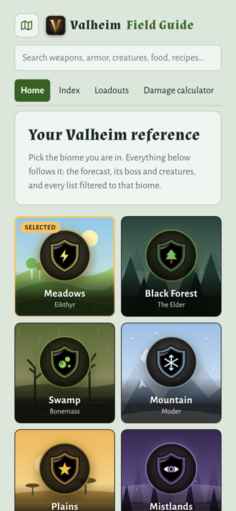
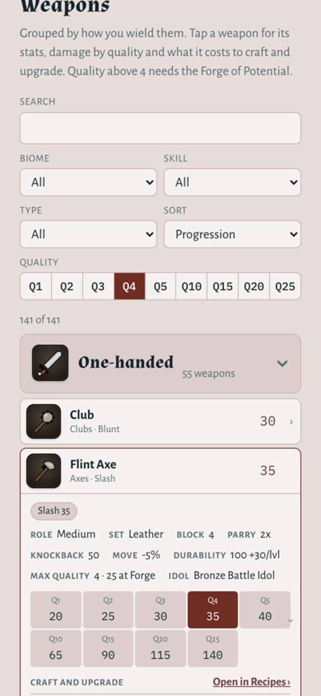
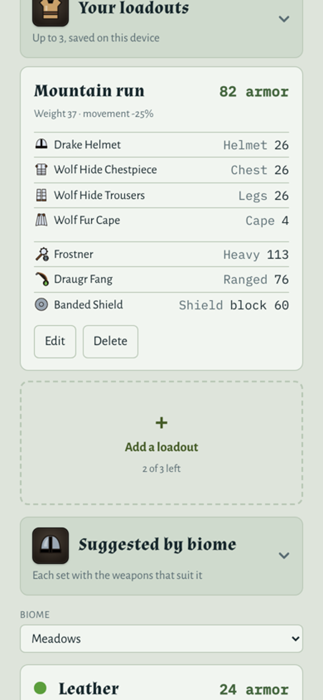
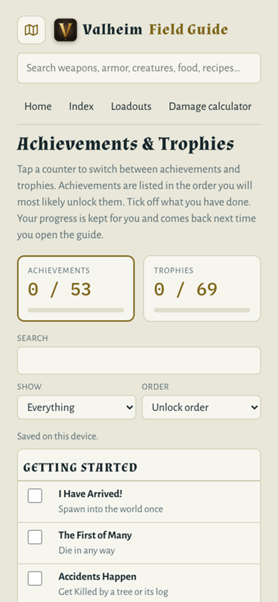

# Valheim Field Guide

A fast, offline Valheim reference for your phone: every weapon, armor set, creature, material,
food, recipe, station, merchant item, trinket and gem in **Valheim 1.0**, with stats at any
upgrade quality, up to Q25 at the Forge of Potential.

**[Use it in your browser](https://OWNER.github.io/REPO/)** ·
**[Download the Android app (APK)](../../releases/latest)** ·
**[Report a problem or suggest something](../../issues/new/choose)**

<p>
  
  
  
  
</p>

## What's in it

- **Pick your biome** on the home screen and everything follows it: boss, mini-boss, the
  strongest creature, materials, and the weather and wind forecast (it uses the game's own seeded
  forecast, so it matches every world).
- **Weapons and armor** with damage, block, armor and durability at Q1–Q5, then every 5 levels up
  to Q25, plus craft and upgrade costs for each level.
- **Creatures** with health, weaknesses, drops and star levels. **Materials** with where to find
  them and what they make.
- **Food, meads, recipes, crafting stations, merchants, trinkets and gems**, all searchable, filterable
  and grouped by biome or type. Every category can be collapsed.
- **Loadouts**: build up to 3 of your own (armor, two weapons and a shield) and see total armor,
  weight, movement penalty, damage and set bonuses at any quality. Suggested sets for every biome too.
- **Damage calculator**, **achievement and trophy tracker**, and **console commands** with
  tap-to-copy.

No account, no ads, no tracking. Everything you save stays on your device. Use **Copy backup** at
the bottom of any page to move it to another device.

## Installing the Android app

1. On your phone, open the [latest release](../../releases/latest) and download
   `ValheimFieldGuide.apk`.
2. Open it. The first time, Android asks you to allow installs from your browser or Files app.
3. Tap **Install**. New versions install over the old one and keep your saved data.

## Feedback

This is a fan project and it gets better with your help. If a number is wrong, something's missing,
or you have an idea, please [open an issue](../../issues/new/choose). There are quick forms for
data corrections, bugs and ideas.

## Building it yourself

You need Node 22. For the APK you also need Java 21 and the Android SDK.

```bash
npm ci
npm run build:web          # builds www/index.html (open it in a browser)
npx cap sync android       # copies it into the Android project
cd android && ./gradlew assembleRelease
```

Without a signing key the APK is signed with your debug key. GitHub Actions builds the official APK
and the web version on every push to `main`.

**Layout**
- `web-src/src.html`: the whole app (one page, plain HTML/CSS/JS, no framework)
- `web-src/data.json`: the game data the page is built from
- `build-web.mjs`: builds the page; bundles fonts for offline use; in the app, saves to native storage
- `android/`: the Android wrapper ([Capacitor](https://capacitorjs.com))

## Credits and disclaimer

Fan-made and unofficial. Not affiliated with or endorsed by Iron Gate AB or Coffee Stain Publishing.
Valheim is a trademark of its owners. All icons and artwork in this app are original drawings,
not game assets.

Game data was compiled by hand and checked against the community
[Valheim Wiki](https://valheim.weirdgloop.org/), which is maintained by its editors under its
Creative Commons license. Thank you to everyone who keeps it up to date.

Code is released under the [MIT License](LICENSE).
